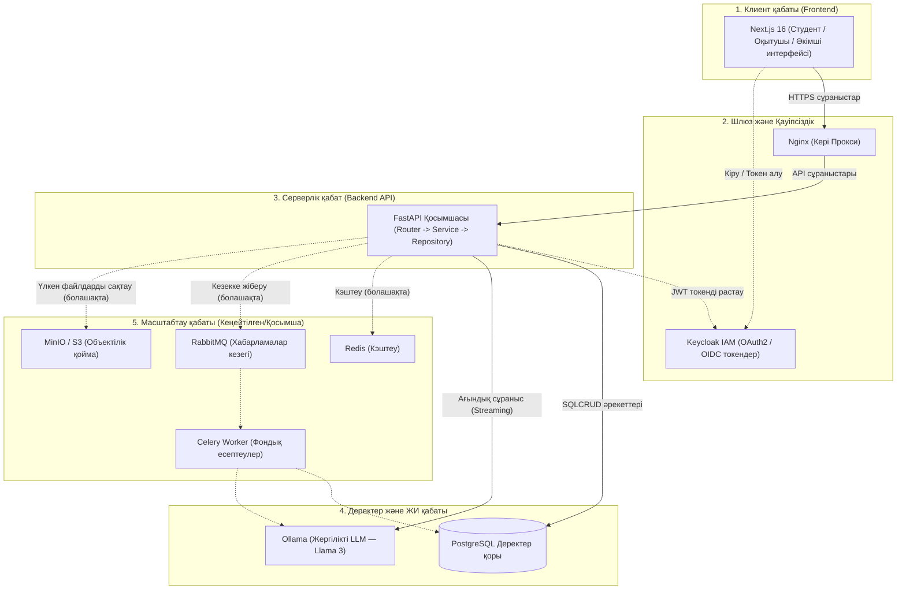

# Веб-қосымша архитектурасы (6-сабақ)

## 1. Жоба сипаттамасы

> **Мақсаты:** Қазақстандағы бағдарламалау негіздерін оқитын студенттерге жергілікті ЖИ (Ollama) арқылы кодтағы қателерді өз бетінше түсінуге нұсқаулық (hint) беру және оқытушыларға студенттердің зертханалық тапсырмаларын басқарып, бағалауға мүмкіндік беретін білім беру веб-платформасы.  
> **Негізгі User Story-лер:** [docs/user-stories.md](user-stories.md)  
> **Деректер моделі:** [docs/er-diagram.md](er-diagram.md)  
> **API спецификациясы:** [docs/api.md](api.md)

---

## 2. Архитектуралық құрамдас бөліктер (Компоненттер)

### 2.1. Клиент қабаты (Frontend)
- **Next.js 16 (React 19, TypeScript, Tailwind CSS):**
  - Пайдаланушы интерфейсі (Студент, Оқытушы, Әкімші кабинеттері).
  - Жергілікті LLM жауаптарын нақты уақытта ағындық түрде (streaming) көрсетуге арналған интерактивті кеңес/сұрақ беру компоненті.
  - Keycloak арқылы OIDC/OAuth2 протоколымен пайдаланушыларды жүйеге кіргізу және JWT токендерін басқару.

### 2.2. Шлюз және қауіпсіздік (Gateway & IAM)
- **Nginx (Кері прокси):** Барлық сыртқы HTTPS сұраныстарын қабылдау, статикалық файлдарды тарату және сұраныстарды тиісті ішкі сервистерге (Frontend және Backend) бағыттау.
- **Keycloak (Auth & IAM):** Пайдаланушылардың тіркелуі, кіруі, құпиясөздерді сақтау, JWT токендерін жасау және рөлдерді (`student`, `teacher`, `admin`) орталықтан басқару.

### 2.3. Қолданбалы сервер қабаты (Backend API)
- **FastAPI (Python 3.11+):**
  - Асинхронды RESTful API қызметі.
  - Архитектуралық қабаттарға бөлінуі:
    - `Router`: HTTP сұраныстарын қабылдау және Keycloak JWT рөлдерін тексеру;
    - `Schema`: Кіріс/шығыс деректерін Pydantic арқылы валидациялау;
    - `Service`: Бизнес-логика және ережелер (дедлайн тексеру, балл диапазоны, курсқа жазылу);
    - `Repository`: Деректер қорымен SQLAlchemy арқылы асинхронды жұмыс;
    - `Core`: Баптаулар, қауіпсіздік және деректер қорымен байланыс.

### 2.4. Деректер мен ЖИ қабаты (Storage & Local LLM)
- **PostgreSQL 16:** Барлық негізгі деректерді (`users`, `courses`, `enrollments`, `assignments`, `submissions`, `ai_hints`) сенімді реляциялық құрылымда сақтау.
- **Ollama (Жергілікті LLM):** Деректердің қауіпсіздігі мен құпиялылығын қамтамасыз ететін, серверде оқшауланып іске қосылатын LLM (Llama 3 / Mistral) модулі. Студенттерге код қатесін талдау (hint) және оқытушыға тапсырма құру бойынша сұрақ үлгілерін ұсынады.

---

## 3. Архитектуралық сызба (Mermaid Flowchart)

---

## 4. Деректердің өзара байланыс ағыны (Data Flow)

1. **Студент курсқа жазылғанда:**
   `Next.js` → `Nginx` → `FastAPI Router` (Keycloak JWT тексеріледі) → `Service` (курстың бар-жоғы және бұрын жазылғаны тексеріледі) → `Repository` → `PostgreSQL` (`enrollments` кестесіне жазылады).
2. **Студент тапсырма шешімін жүктегенде:**
   `Next.js` → `Nginx` → `FastAPI Router` → `Service` (дедлайн мен файл тексеріледі) → `Repository` → `PostgreSQL` (`submissions` кестесіне код және файл атауы жазылады).
3. **Студент ЖИ көмекшісінен кеңес сұрағанда:**
   `Next.js` → `FastAPI Router` → `Service` (жүйелік промпт қосылады: «тек бағыт бер, толық код жазба») → `Ollama API` (жауапты streaming түрінде кері қайтарады) → сұрау нәтижесі `ai_hints` кестесіне сақталады.
4. **Оқытушы жұмысты бағалағанда:**
   `Next.js` → `FastAPI Router` (тек `teacher` рөлі тексеріледі) → `Service` (балл 0–100 арасында тексеріледі) → `Repository` → `PostgreSQL` (`submissions` күйі мен балы жаңартылады).

---

## 5. Архитектуралық талдау және шешімдер журналы (Prompt Log)

> **Мақсат:** Архитектурадан бес белгі бойынша артық (over-engineering) ұсыныстарды анықтап, MVP көлемінде жүйені оңтайлы әрі жеңіл ұстау.

### 5.1. MVP үшін бекітілген негізгі бөліктер:
- **Next.js 16 + FastAPI + PostgreSQL + Keycloak + Ollama.** Бұл құрам жобаның барлық Must story-лерін артық инфрақұрылымсыз толық қамтамасыз етеді.

### 5.2. MVP деңгейінде қабылданбаған артық ұсыныстар:

| № | Не ұсынылды (Құрамдас бөлік) | Неге қабылданбады (Сын/Себебі) |
|---|---|---|
| 1 | **RabbitMQ + Celery Worker** (Хабарламалар кезегі) | **Тым ерте енгізілген асинхрондылық.** MVP кезеңінде пайдаланушылар саны аз. FastAPI өздігінен асинхронды (`asyncio`, `httpx`) жұмыс істейді және Ollama-мен тікелей ағындық (streaming) байланыс орната алады. Бөлек брокер мен воркерлерді қосу күрделілікті және серверге түсетін шығынды негізсіз арттырады. |
| 2 | **MinIO / S3 Object Storage** (Бөлек файлдық қойма) | **Артық инфрақұрылым.** Студенттердің зертханалық жұмыстары негізінен шағын мәтіндік файлдар (`.py`, `.txt`). Олардың мәтіндік кодын тікелей PostgreSQL ішіндегі `text` өрісінде (`submissions.code`), ал атауын `file_name` өрісінде сақтау әлдеқайда жеңіл әрі тиімді. Бөлек S3 қоймасы бастапқы кезең үшін артық. |
| 3 | **Redis Cache** (Кэштеу қабаты) | **Мерзімінен бұрын оңтайландыру (Premature optimization).** Жобаның алғашқы нұсқасында курстар мен тапсырмалар саны шектеулі, сұраныс қарқыны төмен. PostgreSQL сұраныстарды жылдам орындайды. Кэш инвалидациясы мен қосымша жад сервисін басқару жүйеге артық салмақ салады. |
