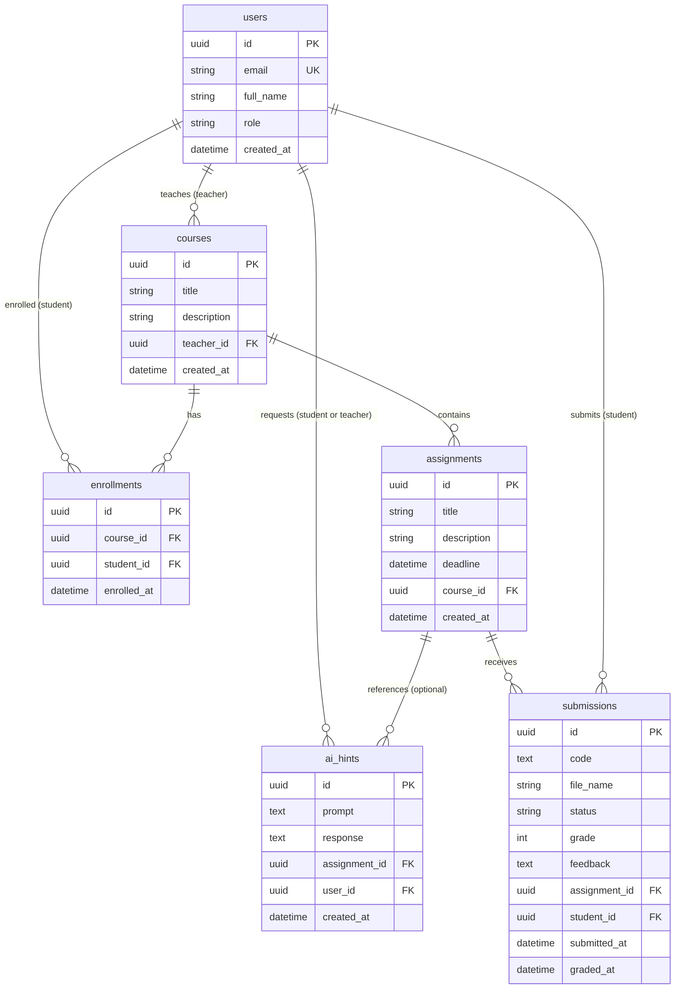

# Деректер моделі (6-сабақ)

## Кестелер
- **users:** id, email, full_name, role, created_at
- **courses:** id, title, description, teacher_id, created_at
- **enrollments:** id, course_id, student_id, enrolled_at
- **assignments:** id, title, description, deadline, course_id, created_at
- **submissions:** id, code, file_name, status, grade, feedback, assignment_id, student_id, submitted_at, graded_at
- **ai_hints:** id, prompt, response, assignment_id, user_id, created_at

---

## Байланыстар
- **users 1 — көп courses:** бір оқытушы (`teacher`) көптеген курстарды басқарады (`teacher_id`)
- **users 1 — көп enrollments:** бір студент (`student`) көптеген курстарға жазылады (`student_id`)
- **courses 1 — көп enrollments:** бір курста көптеген студенттер оқиды (`course_id`)
- **courses 1 — көп assignments:** бір курс көптеген тапсырмалардан тұрады (`course_id`)
- **assignments 1 — көп submissions:** бір тапсырмаға көптеген студенттер өз шешімдерін жібереді (`assignment_id`)
- **users 1 — көп submissions:** бір студент көптеген тапсырма шешімдерін жүктейді (`student_id`)
- **users 1 — көп ai_hints:** бір пайдаланушы (студент немесе оқытушы) AI көмекшісіне көп сұраныс жасайды (`user_id`)
- **assignments 1 — көп ai_hints:** бір тапсырма бойынша бірнеше AI кеңестері немесе сұрақ үлгілері сақталуы мүмкін (`assignment_id`, nullable)

---

## ER диаграммасы

---

## Ұсыныстар мен талдау (Агент есебі)

1. **Көп — көп байланыс шешілді:** `users` (student) және `courses` арасындағы байланыс `enrollments` аралық кестесі арқылы толық үйлестірілді.
2. **Файл және код үйлесімділігі:** Студенттің жүктеген файлының атауы `file_name` бағанында, ал мазмұны `code` мәтіндік өрісінде сақталады.
3. **Әмбебап ЖИ сақтау:** `ai_hints` кестесі `user_id` арқылы студенттің де (hint), оқытушының да (generate-questions) ЖИ-ге жасаған сұрауларын бірыңғай сақтауға бейімделді.
4. **Қауіпсіздік:** Құпиясөздер Keycloak (OIDC) арқылы сақталады, деректер қорында құпиясөз өрісі жоқ.
