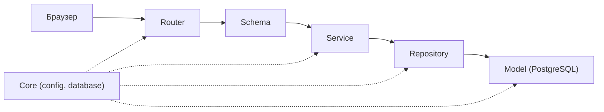

# Қабат картасы (4-сабақ)

| Қабат | 1-әрекет: Студент тапсырма шешімін жүктейді | 2-әрекет: Оқытушы студент жұмысын бағалайды |
|---|---|---|
| **Router** | POST /api/v1/submissions әдісі · student рөлі | PATCH /api/v1/submissions/{id}/grade әдісі · teacher рөлі |
| **Schema** | SubmissionCreate кіріс схемасы → SubmissionResponse моделі | GradeUpdate кіріс схемасы → GradeResponse моделі |
| **Service** | Тапсырма дедлайнын тексеру; файл пішімін тексеру | Бағалау баллын тексеру; мұғалім құқығын растау |
| **Repository** | SubmissionRepository.create шешімді базаға сақтайды | SubmissionRepository.update_grade нәтижені базада жаңартады |
| **Model** | submissions кестесіне жаңа жазба қосады | submissions кестесінде баға бағанасын өзгертеді |
| **Қате-HTTP** | Тапсырма тапсыру мерзімі өтті → 400 Bad Request | Бағаланатын студент жұмысы табылмады → 404 Not Found |

## Біздің ереже
- Router-де SQL жоқ, service-те HTTPException жоқ
- Құпиялар тек .env-те
